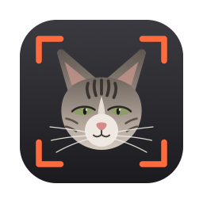
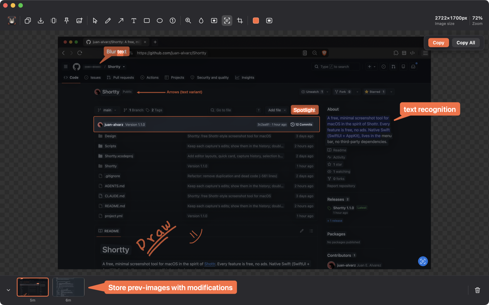
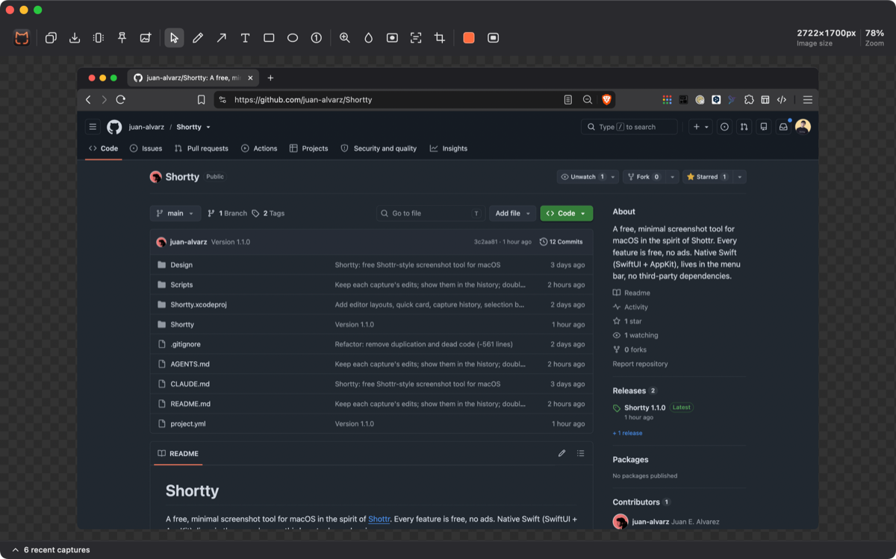
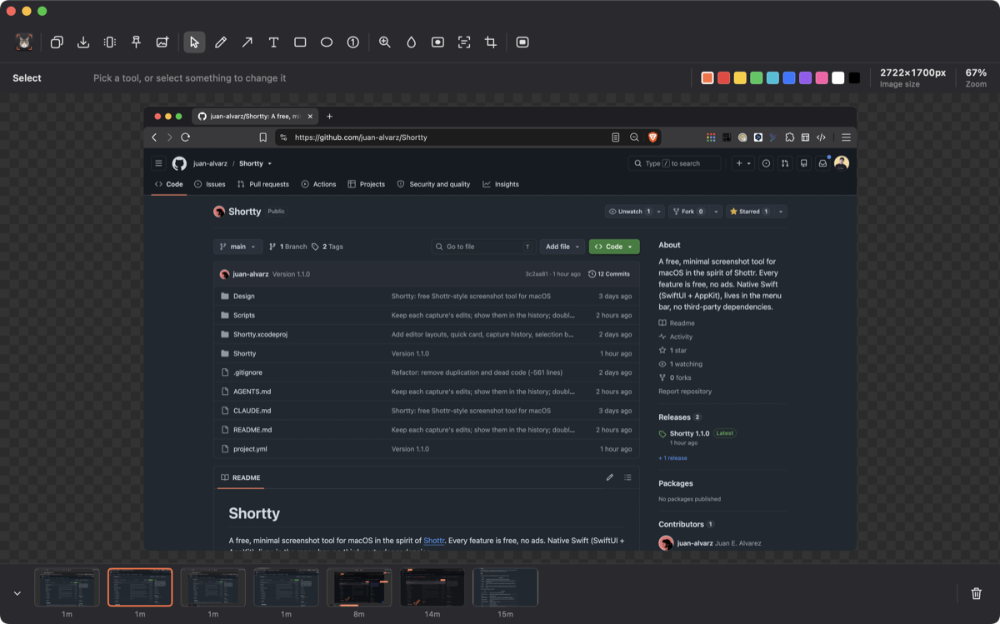
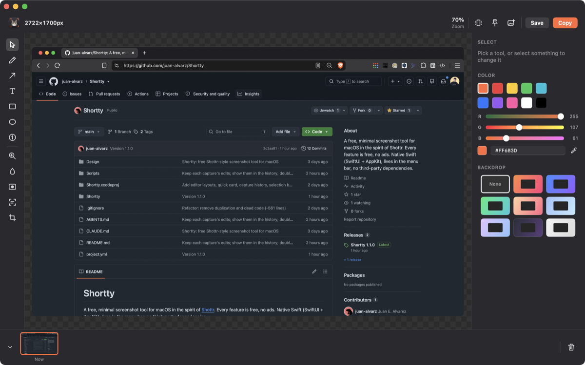
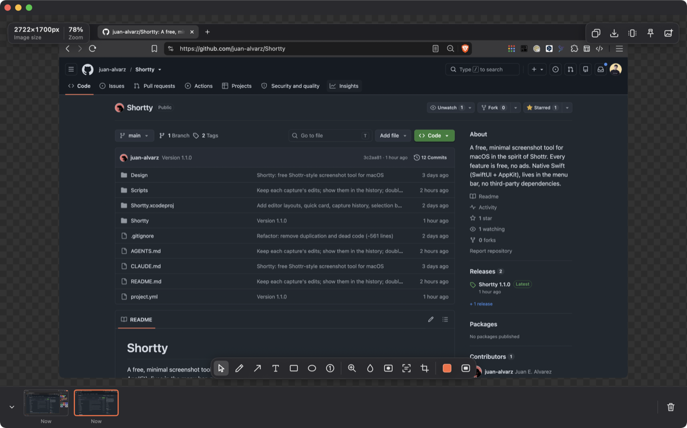

<div align="center">



# Shortty

**A free, minimal screenshot tool for macOS.**<br>
Capture, mark up and share in seconds, in the spirit of [Shottr](https://shottr.cc). Every feature is free, no ads.

[](https://github.com/juan-alvarz/Shortty/releases/latest)


[](LICENSE)

[Download](https://github.com/juan-alvarz/Shortty/releases/latest) · [How to install](#how-to-install) · [Features](#features) · [Customization](#customization)



</div>

## Features

- **Every kind of capture.** Region, window, screen, scrolling pages, delayed shots, or just the text and QR codes in an area, straight to the clipboard.
- **An editor where nothing gets flattened.** Arrows, text callouts, shapes, numbered steps, magnifier, blur and spotlight. Select anything later to move, resize or recolor it.
- **Text Card.** Drag over code, a terminal or a chat, and it's redrawn as a clean window-like card with every word in its original color, so syntax highlighting survives. Tune the background, size and title bar, fix a word, then share it.
- **Pick up where you left off.** The last 20 captures keep their edits, even after a relaunch.
- **Private.** No account, no tracking. Text is recognized on-device with Apple's Vision and Live Text; nothing leaves your Mac.
- **Native and light.** Swift, SwiftUI and AppKit, no third-party dependencies. Lives in the menu bar.

## How to install

Shortty is free, so it isn't signed with a paid Apple Developer ID. Nothing to pay either way; there are two ways in.

### Option 1: download the app

1. Download the latest `Shortty-X.Y.Z.dmg` from [Releases](https://github.com/juan-alvarz/Shortty/releases/latest).
2. Open it and drag **Shortty** onto **Applications**.
3. Open Shortty. macOS says it can't verify the developer: close that message (don't move it to the Trash).
4. Open **System Settings → Privacy & Security**, scroll down to Security, and click **Open Anyway** next to
   "Shortty was blocked". Confirm with Touch ID or your password. This is only needed once.
5. Take a capture. macOS asks for **Screen Recording**: allow Shortty, and reopen it if macOS asks you to.
6. Set your shortcuts in Settings → Shortcuts. None are set out of the box.

If you'd rather use the terminal for step 4, this removes the "downloaded from the internet" flag instead:

```bash
xattr -dr com.apple.quarantine /Applications/Shortty.app
```

To update, drag the new version over the old one. Screen Recording stays allowed. The download is for Apple
silicon Macs with macOS 14 or later.

### Option 2: build it yourself

Building on your own Mac needs no Apple account and shows no warning, because apps you build aren't flagged as
downloaded. It works on any Mac with macOS 14 or later.

You need Xcode (free on the App Store) and [xcodegen](https://github.com/yonaskolb/XcodeGen):

```bash
brew install xcodegen
git clone https://github.com/juan-alvarz/Shortty.git
cd Shortty
Scripts/install.sh
```

`install.sh` builds Shortty, installs it to `/Applications/Shortty.app` and opens it (`--profile-only` installs to
`~/Applications` instead, just for your account, with no admin rights needed). The first run also creates a
free local code-signing certificate ("Shortty Dev") in your login keychain, and macOS asks for your login password
once to trust it. That certificate is what lets macOS remember the Screen Recording permission each time you
rebuild. To update later:

```bash
git pull && Scripts/install.sh
```

## Capture

Every action is in the menu bar menu, and each can have a global shortcut ([Shortcuts](#shortcuts)).

| Action | What it does |
|---|---|
| Capture Region | Drag over an area. Space switches to clicking a window, Esc cancels. |
| Repeat Last Region | The same area as last time, no selecting (remembered across relaunches). |
| Capture Screen | The display under the pointer. |
| Capture Window | Click a window to capture it (without its shadow). |
| Capture Active Window | The front window of the app you're in, instantly. |
| Scrolling Capture | Drag over an area, then scroll the page: frames are stitched into one tall image (sticky headers and footers kept once). Done (Return) or Cancel (Esc) in the small panel. |
| Capture Text | Drag over an area: a QR code's contents, or else its text, go straight to the clipboard. A small notice says what was copied. |
| Lazy Region | Drag the area first, then a countdown runs and that exact area is captured. |
| Lazy Screen | Countdown, then the display under the pointer. |
| Reopen Last Capture | Brings back the editor with the latest capture and its edits, even after a relaunch. |

During a countdown the seconds show next to the menu bar icon, and the menu has "Cancel Lazy Shot".

## Edit

Every capture opens in one editor window (unless Settings → After a capture says otherwise). While it's open, Shortty is a regular app: it's in the Dock and ⌘Tab, and
⌘, opens its Settings. Close the window and Shortty goes back to the menu bar, still running. Everything you draw stays
editable: select it to move it, resize it from its handles, recolor it or change its thickness. Drag over empty space to
select several at once (pictures stay put), then move, recolor or delete them together. Copy and Save close the
editor and say where the picture went.

| Tool | What it does |
|---|---|
| Pencil | Freehand lines. Shift draws a straight one; Shift+Control snaps it to 45° steps. |
| Arrow | Four styles. Drag the middle handle to curve it; Shift snaps to 45°. |
| Text | A callout (bubble with a pointer), a label (filled box) or plain letters. Click to type in place, or drag from where the text goes to what it points at. |
| Rectangle, Ellipse | Outlines. Shift makes a square or a circle. |
| Numbered steps | Click to drop 1, 2, 3… badges; each points from its corner; drag to aim it. Deleting one renumbers the rest. |
| Magnifier | Drag over a small area and a 2× copy appears beside it, joined by a line. |
| Blur | Blur or Erase the area, or only the text found in it (Blur Text, Erase Text). |
| Spotlight | Dims everything except the area and outlines it. Arrows and text on top stay bright. |
| Recognize Text | macOS Live Text over the screenshot: select exactly the words you want and copy them. |
| Text Card | Drag over text (code, a terminal, a chat) and it's redrawn as a clean window-like card, each word in the color it had, so syntax highlighting survives. Before it opens as a new capture, tune the background, text color, size and title bar, fix a word, or select some text and recolor it. |
| Crop | Nothing is thrown away: Reset or undo brings the whole picture back. |
| Ruler | Point at something to measure it: lines run sideways and up and down to the nearest edges, with their length in pixels. Hold `1` for sideways only, `2` for up and down only. |

Also in the editor:

- **Colors**: 10 presets, R/G/B sliders, a hex field and a screen eyedropper. Each tool remembers its own thickness.
- **Selection bar**: whatever is selected gets a small bar with its color, Duplicate, Bring to front, Send to back and Delete.
- **Recent captures**: a slim bar along the bottom opens into the last 20 captures. Click one to keep editing it,
  drag one into any app, or delete them. Edits are saved as you work, and the thumbnails show them.
- **Drag and drop**: drag the handle next to Save into any app or a website's upload box. Nothing piles up in Downloads.
- **Pin to screen**: float the finished picture above every window. Scroll or pinch to resize, Esc to close.
- **Insert pictures**: paste, pick files, capture a new area, or drop image files onto the canvas.
- **Gradient backdrop**: put the result on a gradient card with padding, rounded corners and a soft shadow.
- **Room to work**: draw or type past the screenshot's edges and the canvas grows to fit.

Shortty also opens existing images: Finder "Open With", or `open -a Shortty image.png`.

## Customization

### Layouts

Settings → General → Layout arranges the editor four ways. Switch any time; the open editor follows.

<table>
<tr>
<td width="50%" valign="top">
<br>
<b>Classic</b><br>
One toolbar with everything. Tool options float at the top right of the picture.
</td>
<td width="50%" valign="top">
<br>
<b>Two rows</b><br>
The toolbar, then a strip with the current tool's options, the colors, size and zoom. Nothing covers the picture.
</td>
</tr>
<tr>
<td width="50%" valign="top">
<br>
<b>Sidebars</b><br>
Tools in a column on the left; options, colors and backdrop on the right; Copy and Save at the top.
</td>
<td width="50%" valign="top">
<br>
<b>Canvas first</b><br>
The picture fills the window. Tools sit in a floating dock at the bottom, output actions at the top right.
</td>
</tr>
</table>

### Shortcuts

**Capture shortcuts are yours to pick.** None are set out of the box: record them in Settings → Shortcuts, which
lists every action with what it does. The lazy shot delay (1–30 s, default 3) is there too.

**In the editor**, hold `⌘` to see each tool's key on its button.

| Key | Tool / action |
|---|---|
| `V` `P` `A` `T` `R` `O` | Select, Pencil, Arrow, Text, Rectangle, Ellipse |
| `N` `M` `B` `S` `X` `K` `C` `U` | Numbered steps, Magnifier, Blur, Spotlight, Recognize Text, Text Card, Crop, Ruler |
| Return | Apply the crop box |
| Shift while drawing | Pencil: straight line (add Control to snap to 45°) · Arrow: snaps to 45° · Rectangle/Ellipse: square/circle |
| `1` / `2` held | Ruler: measure sideways only / up and down only |
| Shift while editing | Corner resize keeps proportions · Move locks to one axis · Arrow middle handle straightens |
| Arrows / Shift+Arrows | Nudge the selection 1 px / 10 px |
| `⌫` | Delete the selection |
| `⌘D` | Duplicate the selection |
| `⌘]` / `⌘[` | Bring the selection to the front / send it to the back |
| `⌘Z` / `⌘⇧Z` | Undo / redo |
| `⌘C` / `⌘S` | Copy / save as `shortty-<timestamp>-image.png` in your save folder |
| `⌘V` | Paste a picture from the clipboard into the canvas |
| `⌘` + scroll, pinch, `⌘+` `⌘-` | Zoom around the pointer · `⌘0` fits |
| Esc | Back to the Select tool; on Select, deselect. Press it twice quickly to close the editor |
| `⌘W` | Close the editor. Shortty keeps running in the menu bar |

### Settings

| Setting | What it does |
|---|---|
| Start Shortty at login | Opens it in the menu bar when you log in. |
| Play sound when capturing | The capture sound. |
| Selection color | The outline while selecting an area or counting down. Follows your Mac's accent color until you pick another. |
| Save folder | Where Save writes. Downloads unless you pick another. |
| After a capture | What to show: the editor, a quick card in the corner of the screen with Copy, Save, Pin and Edit (drag its picture into any app, or click it to edit; it goes away on its own), or nothing but a short notice. Copy and Save also put the capture on the clipboard and in your save folder right away. Out of the box: editor + Copy. |
| Show recent captures | The bar of recent captures in the editor. Delete All removes them from `~/Library/Caches/com.shortty.Shortty/History`. |

## Contributing

Issues and pull requests are welcome. See [AGENTS.md](AGENTS.md) for how the code is organized, how to add
features and how to verify changes.

The app icon's source is `Design/AppIcon.svg`. After editing it, or replacing it with your own 1024×1024 SVG:

```bash
swift Scripts/make-icon.swift && Scripts/install.sh
```

## License

Shortty is free and open source under the [MIT License](LICENSE).
